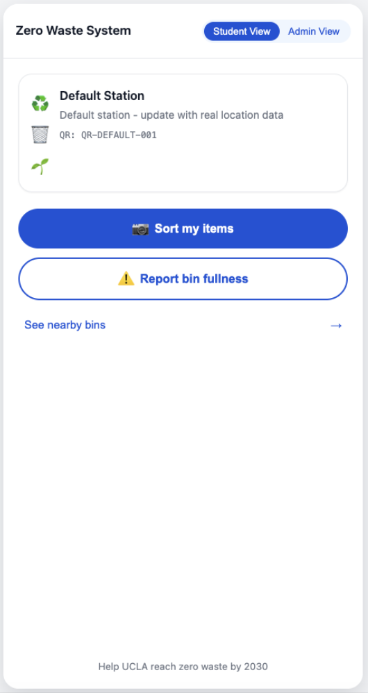
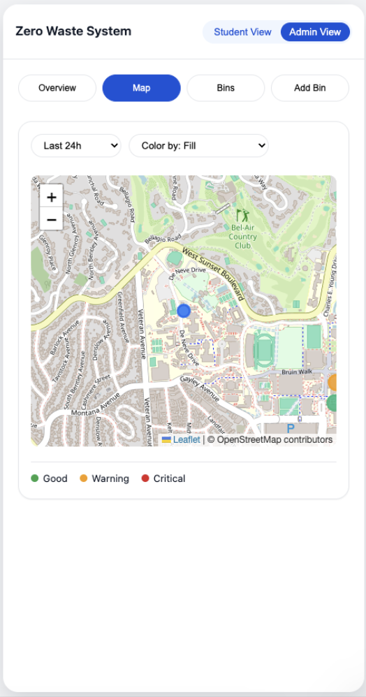

# Zero Waste

Zero Waste is a mobile-focused prototype for finding waste bins, checking bin details, reporting fullness, and getting image-based sorting guidance. It combines a React interface, an Express/MongoDB API, and Python segmentation tools.

The project was evaluated with a small group under controlled conditions. A campus pilot and a partnership with UCLA Facilities Management were proposed next steps, not an established deployment. The [project write-up](Blog-Post.md) describes the research, usability feedback, and limitations.

[Web app setup](website/README.md) · [Segmentation setup](ML-seg/README.md) · [Project poster](Poster.png)

## Runnable demo implementation

[Run the original React / Express / MongoDB demo](deploy/zero-waste/README.md) · [Docker Compose configuration](deploy/zero-waste/compose.yaml) · [Bounded demo backend](website/server/deployment)

The implementation seeds an isolated synthetic database, saves selected-bin reports through the real API, and preserves them in a named MongoDB volume. Administrative and model actions are blocked in demo mode. Local browser and database checks passed; no public backend URL or verified container deployment is claimed.

## Recorded demo

[Watch or download the demo](docs/demos/ZeroWaste-fixed-success-walkthrough.mp4) — **12.2 seconds, silent**. Recorded on 2026-10-12 from the React/Express app connected to local MongoDB with synthetic data. It shows an explicit bin selection, a successful fullness report, and **75% / Warning** after reloading. This is a recorded local demonstration, not a live hosted deployment; segmentation inference is outside this clip.

[Screenshots and recording details](docs/demos/README.md) · [Separate 15-minute technical walkthrough runbook](docs/demos/ZeroWaste-demo-runbook-fixed.md)

[](docs/demos/ZeroWaste-fixed-success-walkthrough.mp4)

## What is in the repository

- **Student interface:** browse and filter nearby bins, inspect details, view bins on a map, and submit fullness reports.
- **Sorting flow:** capture or upload an image, optionally select objects, and request SAM 2.1 masks with Trash-Net classification.
- **Admin interface:** database-backed overview statistics and bins flagged for attention.
- **Data tools:** a sample bin-location import, report generation, and MongoDB models for bins, stations, fullness reports, and impact counters.
- **ML experiments:** a separate YOLO image-preview harness and the SAM + Trash-Net pipeline used by the web API.

Fullness reporting requires an explicit bin selection and saves the report and updated bin status in MongoDB. See the [web app limitations](website/README.md#known-limitations) before treating the prototype as an operational system.

## Architecture

```text
React + Vite + Leaflet
        |
shared API helper (errors, timeouts, API origin)
        |
Express API <----> MongoDB / Mongoose
        |
Python subprocess for /api/segment
        |
SAM 2.1 masks -> Trash-Net crop labels -> overlay + JSON
```

The web server calls the SAM + Trash-Net helper directly. The YOLO harness is a separate experiment, not an automatic first stage of the web request.

| Directory | Contents |
| --- | --- |
| [website/src](website/src) | React screens, shared API helper, camera capture, and map |
| [website/server](website/server) | Express routes, models, and data-import services |
| [ML-seg](ML-seg) | Python inference scripts and dependency list |
| [ML-seg/results/trash-seg](ML-seg/results/trash-seg) | Saved example output, not a benchmark |
| [Blog-Post.md](Blog-Post.md) | Project research, evaluation, and proposed next steps |

## Run locally

```bash
git clone https://github.com/xingzhao-ji/trash-seg.git
cd trash-seg
```

Follow [website/README.md](website/README.md) to install the frontend and server dependencies and point the API at your own development MongoDB database. The documented setup uses frontend port **3000** and API port **5001**, with `VITE_API_BASE_URL` set explicitly.

Browsing bins and using the sample sorting-results UI do not require Python inference. To run real image segmentation, also follow [ML-seg/README.md](ML-seg/README.md). The first inference run may download model weights; no paid inference API is required by these scripts.

## Validation and project status

The web app has a Playwright regression suite for bin selection, fullness-report persistence, visible save errors, and API validation. It runs the actual React/Express app against a disposable local MongoDB with synthetic records. The [web README](website/README.md#validation) gives prerequisites, test commands, and the scope of verification; the [ML README](ML-seg/README.md#validation-and-limits) explains how to exercise the image scripts.

The historical evaluation covers usability, not a measured campus-wide reduction in contamination or a systematic model-accuracy benchmark. The current code also uses a shared demo impact record, has no admin authentication boundary, and contains manually selectable example results. Those examples are distinct from model output.

## Team

The [poster](Poster.png) credits **Brian Brito, Alex Chen, Yahvin Gali, and Jared Ji**.

| Contributor | Main contribution areas |
| --- | --- |
| Jared Ji | React student bin browsing, bin details and fullness-reporting flow; shared API helper with error handling, timeouts and environment configuration; MongoDB integration |
| Alex Chen | Admin interface and model work |
| Brian Brito | Camera capture and map interface |
| Yahvin Gali | Classification work |

These areas describe individual contributions within a team project. The app, experiments, research, and evaluation were collaborative work.

## Project images

| Student interface | Admin interface |
| --- | --- |
|  |  |

[Sorting interface](ai.png) · [Full project poster](Poster.png)
