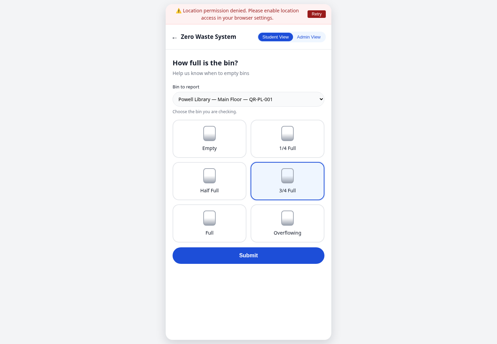
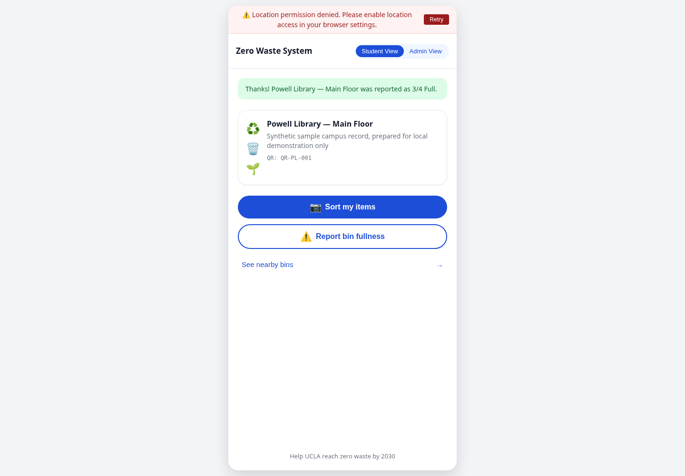
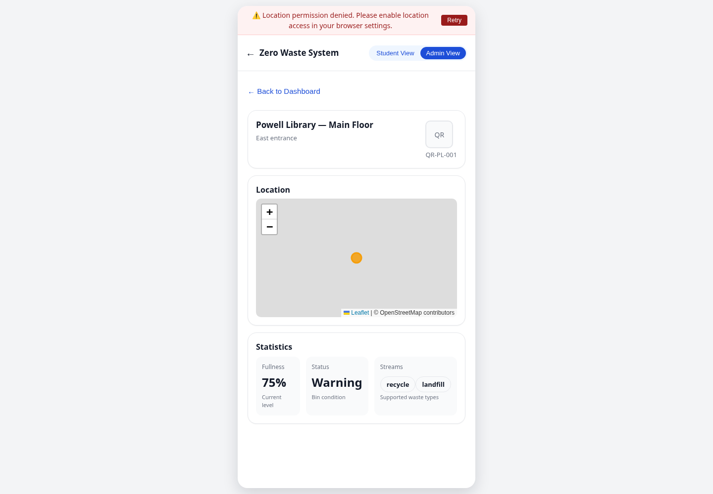

# Recorded Zero Waste demo

[Watch or download the MP4](ZeroWaste-fixed-success-walkthrough.mp4) · [15-minute technical walkthrough runbook](ZeroWaste-demo-runbook-fixed.md) · [Local setup](../../website/README.md#local-setup)

The **12.2-second silent recording** shows the actual React/Vite interface and Express API connected to **local MongoDB**, captured on **2026-10-12** at [revision 729bab0](https://github.com/xingzhao-ji/trash-seg/commit/729bab0865c7d49f98db8bcb529dfa94e81b9d7f). It is a recorded local demonstration, **not a live hosted deployment**. The separate runbook outlines a 15-minute technical presentation; the video itself is not 15 minutes long.

The recording selects **Powell Library — Main Floor**, submits **3/4 Full**, shows the saved confirmation, then reloads and opens that bin's detail view at **75% / Warning**. The report was saved in the local demonstration database. Campus locations are repository sample records; activity, fullness, and impact values are synthetic. They do not represent a live facilities feed, sensor readings, or measured campus outcomes.

## Screenshots

| Choose the bin and level | Confirm the report was saved | Inspect the saved value after reload |
| --- | --- | --- |
|  |  |  |

## Scope and reproduction

Follow the [web setup](../../website/README.md#local-setup) with a disposable local database and the [regression-test instructions](../../website/README.md#fullness-regression-suite). The regression suite verifies selection, stored reports, updated history, persistence after reload, and visible error/retry behavior against its own temporary database. The [runbook](ZeroWaste-demo-runbook-fixed.md) includes the captured dataset's before/after notes and a timed product and technical walkthrough.

The location-permission-denied banner is visible because no device location was shared. External map tiles did not load during capture, so the detail view has a marker on a gray map. The recording does not verify geographic map rendering, camera hardware, segmentation inference, production authorization, or a campus deployment. Team contributions remain credited in the [main README](../../README.md#team).

The original MP4 and three PNGs are included without visual edits. The MP4 is H.264 at 1440 × 1000, 25 fps, with no audio stream; each screenshot is 1440 × 1000. The complete demo bundle is under 500 KiB.
